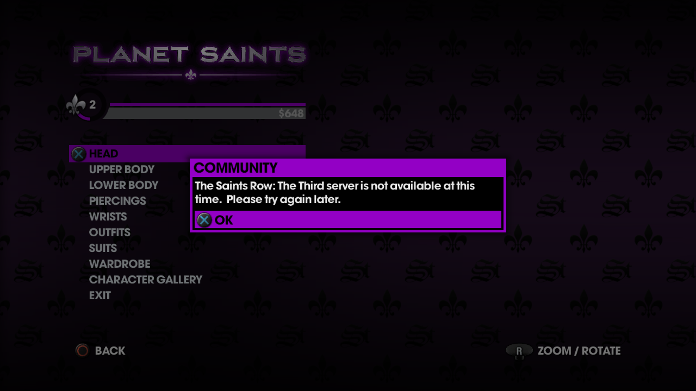
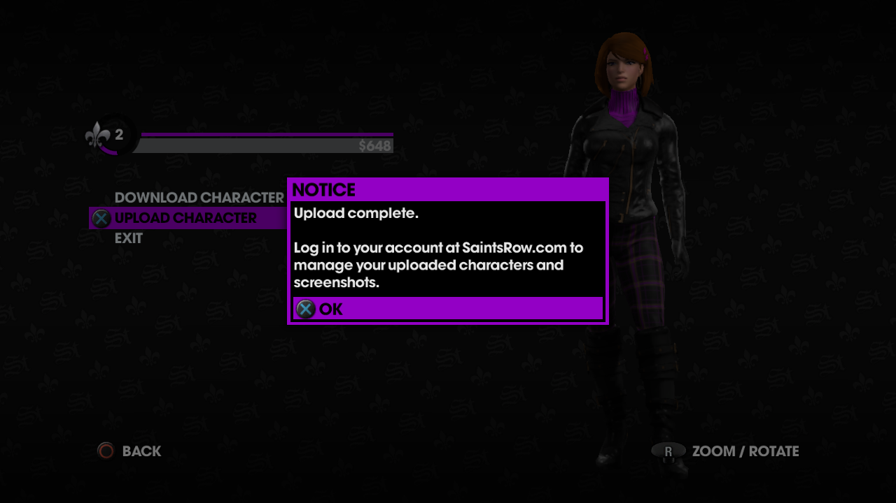
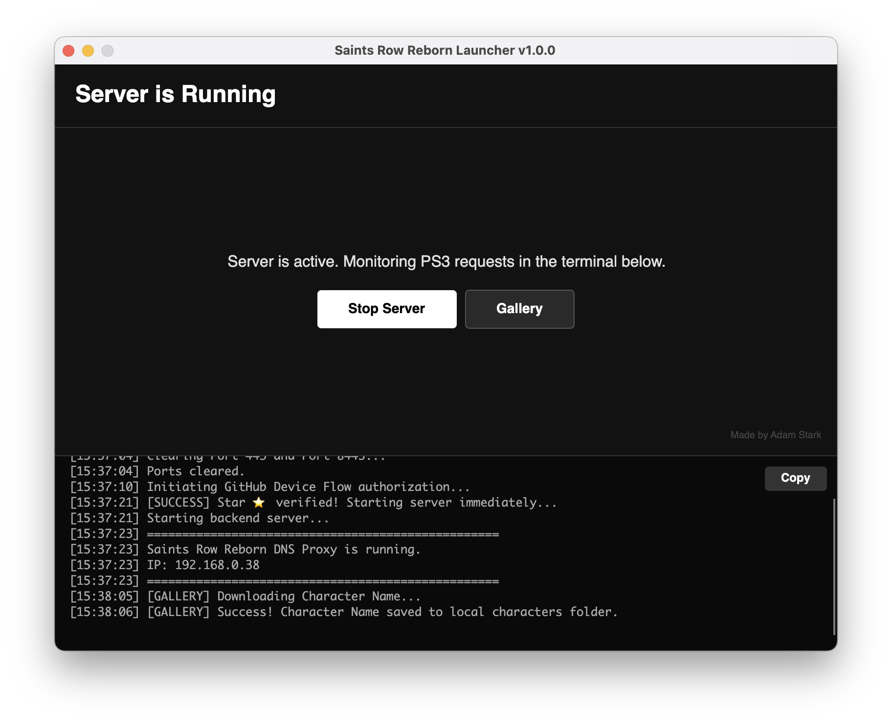

# Saints Row Reborn PS3
> [!IMPORTANT]
> This project brings back the Character Sharing functionality and the "Jumped In" trophy for Saints Row: The Third and Saints Row IV.

A cross-platform custom server and launcher to restore the Platinum trophy and Character Sharing functionality for **Saints Row: The Third** and **Saints Row IV** on the PlayStation 3 and RPCS3.

|             BEFORE: Server Error              |             AFTER: Server Online             |
|:---------------------------------------------:|:--------------------------------------------:|
|  |  |

These screenshots are from Saints Row using RPCS3.

## Download
**Please leave a star ⭐ if you found this repository helpful!**  
📅 **TBD:** Release 1.0.0 is here!

You can download the compiled versions for your operating system here:  
**[Download Latest Release.](https://github.com/adamstark1/SaintsRow-Reborn-PS3/releases)**

| UI Screenshot |
| :---: |
|  |

## All Reborn Projects
I managed to restore the Platinum trophies for these games with the help of some amazing people. Feel free to check them all out! :)
- [inFAMOUS 2](https://github.com/adamstark1/inFAMOUS-Reborn-PS3)
- [inFAMOUS: Festival of Blood](https://github.com/adamstark1/inFAMOUS-Reborn-PS3)
- [Darksiders II](https://github.com/adamstark1/Darksiders2-Reborn-PS3)
- [Saints Row: The Third](https://github.com/adamstark1/SaintsRow-Reborn-PS3)
- [Saints Row IV](https://github.com/adamstark1/SaintsRow-Reborn-PS3)

## How to Run
> [!NOTE]
> The application was tested on Windows 11, macOS Tahoe and Ubuntu 22.04.
### Windows
1. Extract the downloaded `.zip` file or compile it yourself with `Compilers/build_windows.sh` (use [Git Bash](https://git-scm.com/install/) terminal).
2. Run `SaintsRowReborn.Launcher.exe`.

### macOS
1. Extract the downloaded `.zip` file or compile it yourself with `Compilers/build_mac_silicon.sh` or `Compilers/build_mac_intel.sh`.
2. Double-click the `Saints Row Reborn.app` bundle. 

### Linux
1. Extract the downloaded `.zip` file or compile it yourself with `Compilers/build_linux.sh` and run `install.sh`.
2. Run `Saints Row Reborn` from application menu. 

## Setup Instructions

1. **Clear Ports:** Click the button in the Launcher to free Port 443 and Port 8443 (HTTP). These are required for the application to intercept PS3 traffic.
2. **PS3 Network Configuration:**
   * On your PS3, go to **Settings > Network Settings > Internet Connection Settings**.
   * Select **Custom**.
   * Select **Wired Connection** or **Wireless**.
   * Go through the settings normally until you reach **DNS Setting**.
   * Select **Manual**.
   * Enter the IP address shown in the Launcher as your **Primary DNS**.
   * Leave the **Secondary DNS** blank (or `0.0.0.0`).
   * Save settings and test the connection.
4. **Optional Step:** Open the **Internet Browser** on your PS3 and head to http://sr3.hydra.agoragames.com/. If you see my message, you're perfectly set.
5. **Start Server:** Once the DNS is set, click "Start Server" and wait for the timer to end or leave a ⭐ and you'll gain access instantly. The terminal will display your local IP address. Boot the game.

## Sponsors and Contributors
I'd like to give a huge thank you to everyone who helped with this repository. This projects improves overtime thanks to you! This project builds on the protocol work done in [MySteelportEmulator](https://github.com/saintsrowmods2/MySteelportEmulator), which revived the PC (Steam) version. Where my own reverse engineering with [Ghidra](https://github.com/NationalSecurityAgency/ghidra/releases) fell short, that documentation filled in the missing pieces. The PS3-specific parts (DNS proxy, HTTPS setup, handling of the console client's requests) are new.

❤️ **Sponsors:** -  
🛠️ **Troubleshooting:** -

You can support my coding journey and revival projects on [GitHub Sponsors](https://github.com/sponsors/adamstark1).

## Troubleshooting

>**"Port 443 or Port 8443 in use / Server fails to start"**  
If the built-in port clearer fails, manually kill the conflicting processes:
- **macOS:** Open Terminal and run `sudo kill -9 $(sudo lsof -t -i :443 -i :8443)`.
- **Linux:** Open Terminal and run `sudo fuser -k 443/tcp 8443/tcp 53/udp`.
- **Windows:** Open Command Prompt as Administrator and run `for /f "tokens=5" %a in ('netstat -aon ^| findstr :443 ^| findstr LISTENING') do taskkill /f /pid %a`, then repeat for `:8443`.

Executing these commands will free up the necessary ports, and the Launcher will function properly.

>**"Permission denied for compiler .sh scripts"**  
Adjust permissions for these files manually:
* **macOS (Intel):** use `chmod +x build_mac_intel.sh` in Terminal.
* **macOS (Silicon):** use `chmod +x build_mac_silicon.sh` in Terminal.
* **Linux:** use `chmod +x build_linux.sh` in Terminal.
* **Windows:** use `chmod +x build_windows.sh` in Git Bash terminal.

## Tech Stack

- **Backend:** ASP.NET Core (Kestrel web server) handling HTTPS traffic strictly on Port 443 and Port 8443.
- **Frontend:** Avalonia UI driving the cross-platform setup launcher.
- **DNS Routing:** Custom DNS proxy handling UDP Port 53 traffic to filter and reroute specific PSN URLs to the local host.
- **Reverse Engineering:** Ghidra utilized for analyzing the PS3 EBOOT binary to map out undocumented API endpoints.
- **Authentication:** GitHub Device Flow API integrated for repository star verification to bypass wait timers.